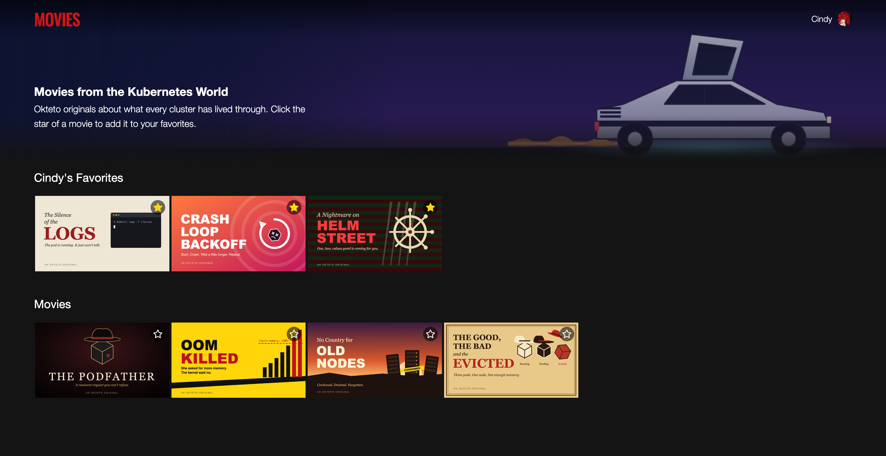
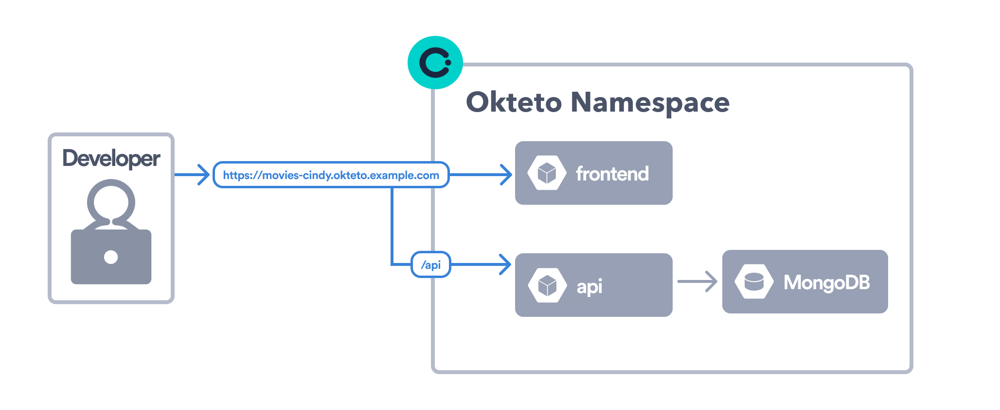

# Movies app

This example shows how to leverage [Okteto](https://www.okteto.com/) to develop a Node.js + React Sample App directly in Kubernetes. The Node + React Sample App is deployed using a Helm Chart. It creates the following components:

- A *React* based frontend, built with [Vite](https://vite.dev) and tested with [Vitest](https://vitest.dev)
- A Node.js API using [Express](https://expressjs.com), which lists the movies and saves your favorites
- A MongoDB database, with the official `mongo` image
- A job to initialize the MongoDB database

The movies are Okteto originals from the Kubernetes world, such as *Crash Loop Backoff* and *The Podfather*. The star of a movie moves it between the favorites and the rest of the movies, and the API saves the change in MongoDB. The posters are drawn in `frontend/posters` and served by the frontend from `frontend/public/posters`.

This is a representation of the Movies app running in an application environment:

Follow this guide to deploy the [Movies app to Okteto](https://www.okteto.com/docs/get-started/deploy-your-app/).

